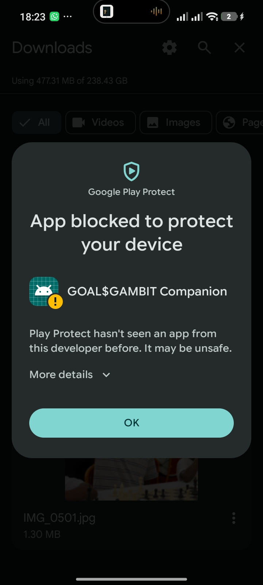

# Welcome to GOAL$GAMBIT

**GOAL$GAMBIT | Compete. Win. Earn.**

GOAL$GAMBIT is a competitive gaming platform for Chess and eFootball. Complete these setup steps before entering paid competitions.

## 1. Install the GOAL$GAMBIT Companion

On a compatible Android phone, sign in to the official GOAL$GAMBIT website and use its **Download the Android app** button. Open the downloaded APK from Downloads and follow the prompts shown on your phone. Android menus vary by device. The companion APK does not install on iPhone.

After installing, open GOAL$GAMBIT Companion and sign in using your existing GOAL$GAMBIT account.

## 2. Google Play Protect warning

The Companion is distributed outside Google Play. Play Protect may show a warning because it has not seen this developer or app before. The warning is not proof that the app is safe or harmful.

Before installing, confirm that the APK came from the official GOAL$GAMBIT website and that its SHA-256 value matches the value shown on the website's setup guide. If you cannot verify the source and file, or Android blocks installation without a verifiable way to proceed, stop and contact GOAL$GAMBIT support. Do not install a copy shared through an unofficial link.

*Example of the Google Play Protect warning that may appear when installing an app outside Google Play.*

## 3. Enable notifications

Allow notifications for GOAL$GAMBIT Companion when Android asks. If you previously denied permission, open Android Settings, find the Companion under Apps, and enable notifications. Android 13 and later may ask for notification permission explicitly. Device notification and battery settings can affect delivery.

The Companion can provide match-related alerts and room-code communication. Keep it installed and signed in when using features that depend on it.

## 4. Fund your wallet before paid competitions

1. Sign in to GOAL$GAMBIT and open **Wallet**.
2. Choose **Deposit**, enter an amount, and follow the payment instructions shown on the website.
3. Wait until the deposit is confirmed and appears in your available balance.

A pending deposit is not available entry money. Funds locked in an active match or another transaction are not available either. Check the entry fee and prize rules before joining. Use only the official payment flow; never send money directly to an administrator as a substitute. Deposit only what you can afford to lose.

## Ready to compete

Keep your account secure, maintain enough available funds for the entry fees you choose, and follow the rules shown for each match or competition. Report results honestly and use the platform's dispute process when needed.

**Welcome to GOAL$GAMBIT. Compete. Win. Earn.**
